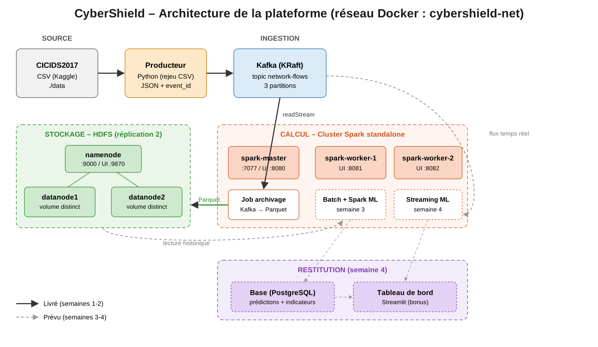

# CyberShield — Détection d'intrusions réseau en temps réel (Big Data)

Plateforme Big Data de classification multiclasse des flux réseau (trafic normal / catégories d'attaques) sur **CICIDS2017**,
basée sur **Kafka, HDFS, Spark, Spark Structured Streaming**.



## Équipe
| Étudiant | Nom et prénom |
|---|---|
| 1 | Ismail … |
| 2 | … |
| 3 | … |
| 4 | … |

## Avancement
- [x] Cluster Docker : Spark (1 master + 2 workers), HDFS (1 NameNode + 2 DataNodes, réplication 2, volumes distincts)
- [x] Ingestion : Kafka (KRaft) + producteur Python rejouant CICIDS2017
- [x] Archivage Kafka → HDFS (Parquet) via Spark Structured Streaming
- [ ] Analyse batch + Spark ML (semaine 3)
- [ ] Inférence streaming + base + dashboard (semaine 4)

## Prérequis
- Docker Desktop (Compose v2), ≥ 8 Go de RAM alloués, ~10 Go de disque
- Dataset CICIDS2017 (Kaggle) : placer les CSV dans `./data/` (non versionnés)
- Versions fixées dans `.env.example` : Hadoop 3.2.1, Spark 3.5.1, Kafka 3.7.0

## Lancement
```bash
cp .env.example .env
make up            # cluster HDFS + Spark + Kafka (+ création du topic network-flows)
make hdfs-init     # répertoires /cybershield/{raw,checkpoints,models}
make check         # 2 DataNodes vivants, dfs.replication = 2
make topics        # 3 partitions sur network-flows
```
Interfaces : HDFS http://localhost:9870 · Spark http://localhost:8080 (2 workers attendus) · Kafka (hôte) `localhost:9094`

## Ingestion
```bash
make produce       # rejoue ./data/*.csv vers Kafka (200 évts/s par défaut)
make peek          # affiche 5 messages
make archive       # Spark Structured Streaming : Kafka -> HDFS Parquet (cluster Spark)
docker compose exec namenode hdfs dfs -ls -R /cybershield/raw/flows | head
```
Options du producteur : `--rate`, `--limit`, `--loop`, `--drop-label` (voir `ingestion/producer.py`).
Exemple de test rapide : `docker compose --profile producer run --rm producer --limit 5000 --rate 500`.

## Format d'un événement
Colonnes CICIDS2017 normalisées en snake_case (`flow_duration`, `destination_port`, … `label`) + `event_id` (UUID),
`event_time` (UTC), `source_file`. `Infinity`/`NaN` → `null`.

## Structure
```
/infra  /ingestion  /batch  /streaming  /dashboard  /docs  /data
```

## Dépannage
- `make reset` supprime conteneurs **et** volumes (HDFS/Kafka repartent de zéro).
- DataNode absent : `docker compose logs datanode1` ; vérifier la RAM allouée à Docker.
- Workers Spark absents de l'UI : `docker compose logs spark-worker-1`.
